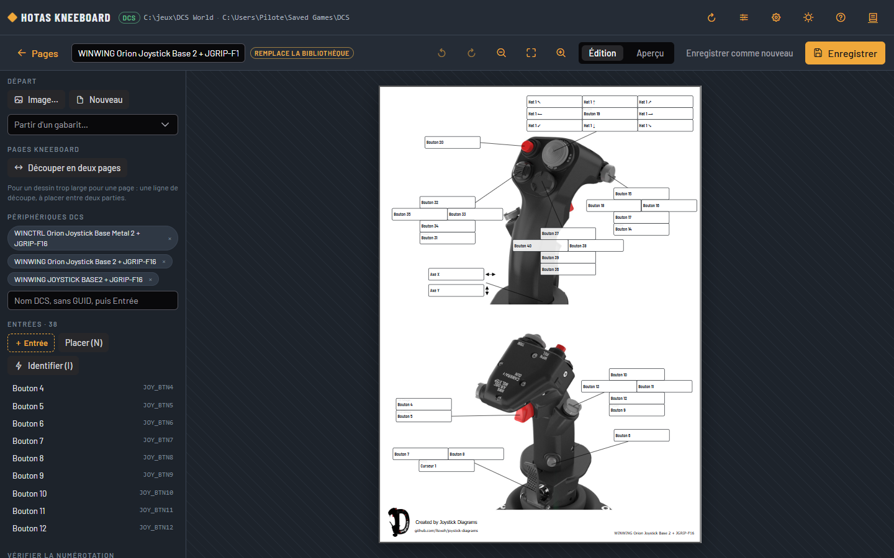
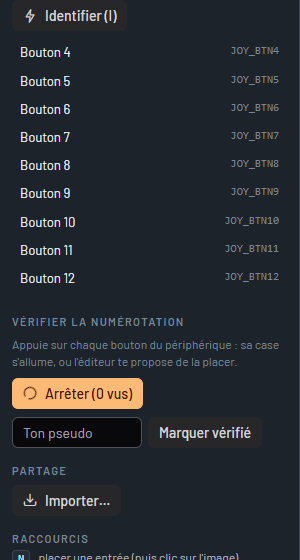

# Template editor

A template is the drawing of a device and the position of each button on it.
The editor is there to draw a device that has none, to correct an existing template, and to check it on the real hardware.

## Opening the editor

- From a device's page: **Create** (it has no template) or **Edit** (it has one).
  The template saved will then be this device's.
- Or with the pencil, at the top of the screen, for a template without a given device.

**Pages** brings back the main screen; the editor warns you if changes are not saved.

## Starting from a picture

Drag a photo or a drawing of the device onto the window (PNG, JPG or SVG), or click **Picture…**.
A picture seen from the front, on a light background, with room around it for the labels, gives the best pages.

You can also start from an existing template (**Start from a template…**):

- if it is this device's template, you correct it, and your version comes before the library's (the "replaces the library's" badge recalls it);
- if it is another device's template, the editor makes a new template of it for yours, without touching the other one;
- a template that names no device (most converted templates, chosen by hand) is corrected in place, and learns your device's name.

## Placing the inputs

An input is a button, a direction of a hat or an axis, as DCS names it.
It has a **box** (where the command is written) and, if you want, a **marker** (a dot on the button, linked to the box by a line).

- Drag **＋ Input** onto the picture, or press `N` then click on the button: a marker is laid, its box beside it.
- Drag the marker or the box; resize the box by its orange corner.
- Choose the input in the list (Buttons 1 to 128, Hats 1 to 4 in the eight directions, Axes).
  Choosing an input already placed swaps the two.
- **With / No marker**, **2nd box** (the same input drawn in two places, on two views of the device), **Duplicate** (on the next button), **Delete**.

### Identifying a button by pressing it

**Identify** (`I` key), then press the device's button: the editor recognises the input and gives it to the selected input (or to the next one you place).
It goes through the browser's Gamepad API, which numbers the buttons its own way: check the number it gives, the list stays the reference.
If the device has just appeared (the browser only shows a controller after a first press), the editor asks you to press a second time.
Hats are not recognised: choose them in the list.

## Check the numbering on the device

**Check** (`V` key), then press every button of the device, one after the other:

- if the button has its box, the box lights up;
- otherwise, the editor asks you to click on the picture where the button is.

The buttons seen show as you go, in green when they have their box.
Once every button is tried and the boxes corrected, enter your nickname and click **Mark as checked**: the page will no longer say "numbering not checked".

## Cutting into two pages

For a drawing too wide for one page (a throttle and its base), **Cut into two pages** adds a blue line.
Drag it through a white area, between two parts of the drawing: it must cut neither the device nor a box.
**Do not cut** removes it.

## Preview, saving, sharing

- **Preview** (`P` key) shows the template with the real bindings of a module: choose the module and the device in the list.
- **Save** (Ctrl+S) puts the template in your library, `%APPDATA%\HOTAS Kneeboard\templates\`.
  The device you opened it for uses it at once.
- **Save as new** makes one more template of it, whatever the template it started from.
- **Export** downloads the template as a file (`.zip`); **Import…** (or dragging and dropping the file) adds it to the library of another PC.
- **Delete the template** removes one of your templates; if it was your version of a library template, the library's comes back.

To give a checked template to everyone, see [Templates](gabarits.en.md#adding-a-template-to-the-library).

## Editor shortcuts

| Key | Action |
|---|---|
| N | Place an input (then click on the picture) |
| I | Identify by pressing the button |
| V | Check: press every button of the device |
| Del | Delete the selection |
| Ctrl + D | Duplicate on the next button |
| ← ↑ → ↓ | Move (Shift: by 10) |
| Ctrl + Z / Ctrl + Y | Undo / redo |
| + − 0 | Zoom, fit |
| P | Preview with real bindings |
| Ctrl + S | Save |
| Esc | Stop placing, deselect |
