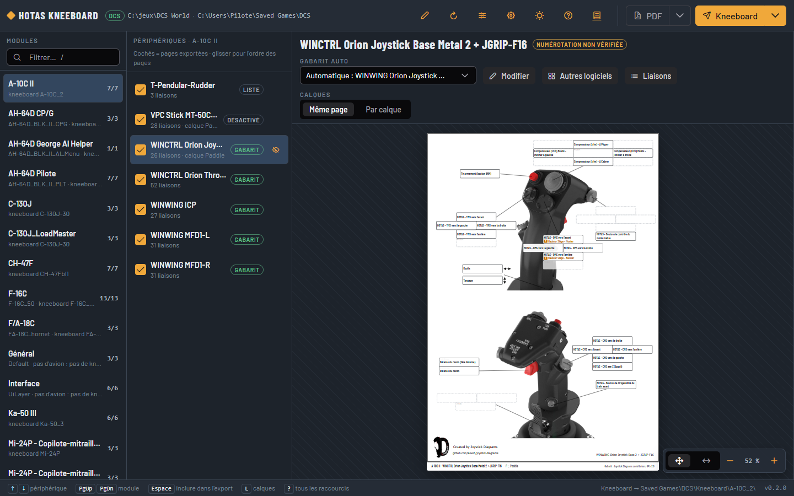
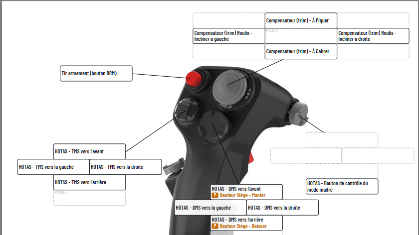
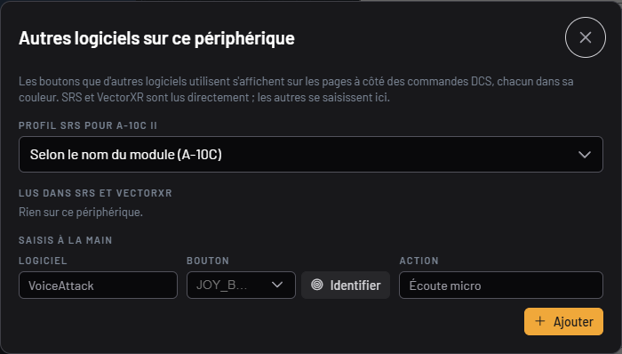
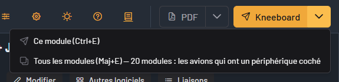
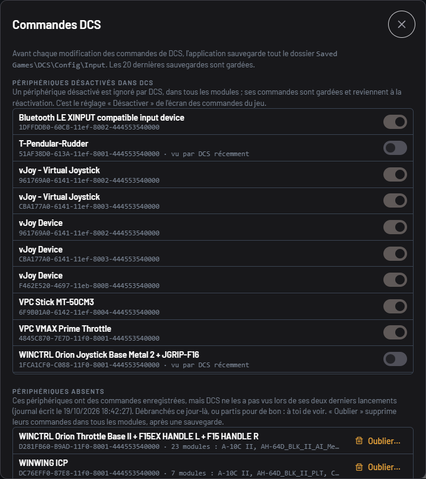
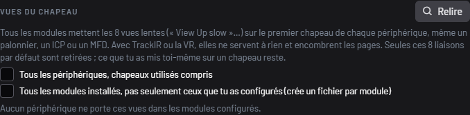
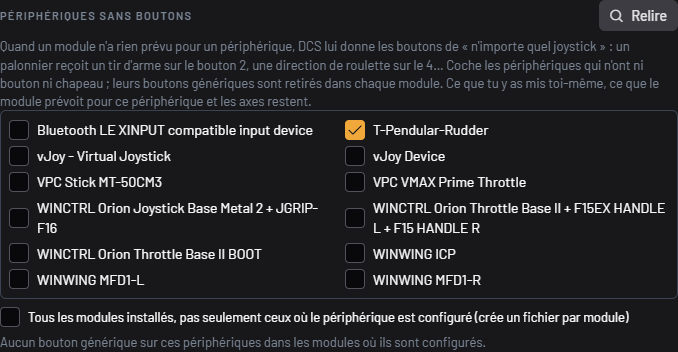
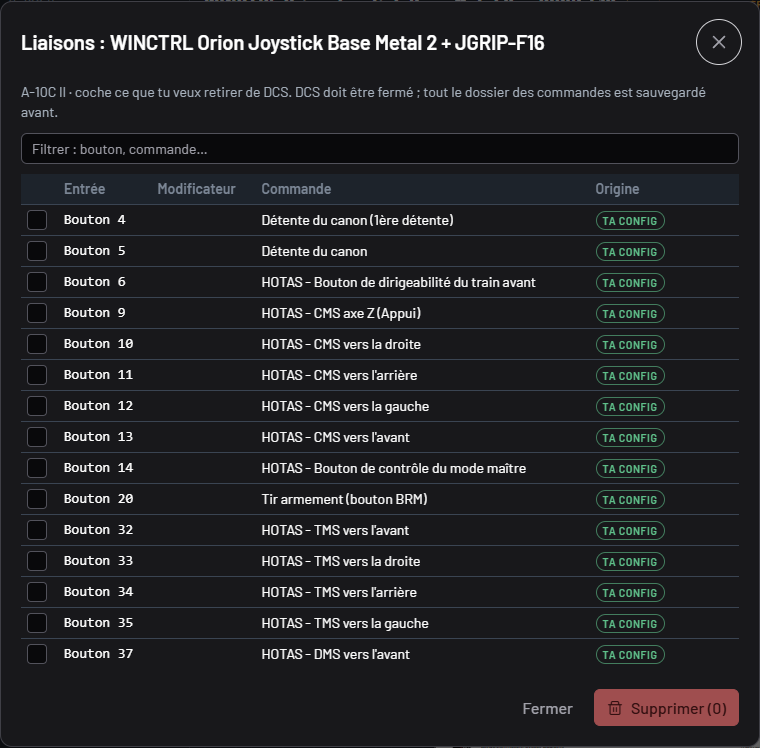
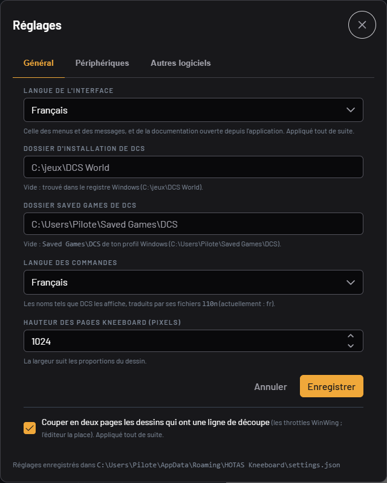

# User guide

## First start

Run `HOTAS-Kneeboard.exe`.
A console opens with the address of the app (`http://127.0.0.1:8642/`) and your browser opens on it.
The app runs as long as the console is open: closing it quits the app.
Running the exe again while it is already running simply opens the browser on the running one.

The app finds by itself:

- the DCS install, in the Windows registry (`HKCU\Software\Eagle Dynamics\DCS World`);
- the `Saved Games\DCS` (or `DCS.openbeta`) folder of your profile;
- the game's language, to show the commands as DCS shows them.

The **DCS** badge at the top is green when everything is found; hover over it to see the folders.
If something is missing, a banner says so, with a direct way to the settings.

The app reads your files without changing them, except when you ask it to change your DCS controls (see [DCS controls](#dcs-controls)): it then backs everything up before writing.
Otherwise, it only writes the kneeboard pages, and its own settings in `%APPDATA%\HOTAS Kneeboard\`.

The interface is in English or in French: by default it follows your browser's language, and the settings let you choose (see [Settings](#settings)).

## The screen

Three columns, from left to right.

**Modules.**
Every controls profile you set up in DCS (an aircraft, a helicopter, the interface layer…), under the name the game's controls screen gives it ("AH-64D Pilot", "F/A-18C"), in alphabetical order.
Under the name, the profile's folder in `Saved Games\DCS\Config\Input` when it differs (`AH-64D_BLK_II_PLT`), and the aircraft's kneeboard folder; on the right, the number of devices exported out of the number of devices shown.
Two profiles with the same name (DCS sometimes keeps the old folder of a renamed module, like `Mi-24P Pilot` and `Mi-24P_pilot`) are told apart by their folder, in brackets.
The filter searches the name, the folder and the aircraft type.
A module DCS does not find in your install is marked "module not installed": only your changes are known, not its defaults.

**Devices.**
The devices set up for this module.
The checkbox includes the device in the exports or not; drag and drop changes the order of the pages.
"template": the device has a drawing; "list": it has none, its page is a list of commands.
The eye, when hovering over a row, hides the device in every module (see [Settings](#settings)).

**The page.**
The page as it will be in the kneeboard, fitted to the room available.
Above it: the template used (found automatically, or chosen by hand in the list, and then remembered), the button to **Create** it or **Edit** it in the editor, the display of the layers.
A choice by hand holds for this device in every module; the first entry of the list, **Automatic**, names the template recognised by the device's name and goes back to it.
When the template chosen by hand is not that one (the stick drawn with the picture of the throttle), the **chosen by hand** badge says so: its tooltip names the template recognised, a click goes back to it.
At the bottom right, the zoom: whole page, full width, more or less (or Ctrl+wheel).

The line between two columns can be dragged to widen or narrow the modules column or the devices one; the app remembers it, and a double click on the line puts back the default width.

In the top bar, the book opens this documentation, the one of your version of the app and in the interface's language, in a new tab; the shortcuts window (`?`) leads there too.

## Reading a page

- **A label per bound button**, laid on the box of the drawing.
  The text shrinks to fit; if it really does not fit, the box gets longer.
- **The dotted boxes** are inputs of the drawing without a command: free buttons.
- **A two-position switch** fits on one label: "LG Handle - UP / DN".
  A released position alone (without a pressed position) is written in italics, after "released:".
- **Modifier layers.**
  A command bound with a modifier (the Warthog's "Paddle", for example) shows in the same label, in colour, after a small badge ("P").
  The legend is at the bottom of the page ("P = Paddle").
  With "Per layer", each layer has its own page.
- **Off template.**
  A command bound to an input that has no box on the drawing is listed under the drawing: nothing gets lost.
  It is often the sign of a template to check (see the [editor](editeur-de-gabarits.en.md#check-the-numbering-on-the-device)).
- **"numbering not checked"**: the template comes from the library and nobody has checked yet, on the real device, that every button lands in the right box.
- **Drawings too wide** for one page (the WinWing Orion throttles, base and handles) are cut into two pages, where the template says; on screen, the two halves are side by side if the window is wide enough.
- **A device without a template** has a list page: the input ("Button 14", "Hat 1 ↑", "Axis X"), then the command.
  If the list is long, it goes on onto a following page.

The words the app writes itself on the pages ("released:", the template's credit line, the head of a list page) are in French when the commands are in French, in English otherwise: a page never mixes two languages.

## The buttons of other programs

A button may serve something other than DCS: SRS's push to talk, VectorXR's overlay, a VoiceAttack voice command.
These buttons show on the pages, beside the DCS commands, each program in its colour and with its badge ("SRS", "VXR" for VectorXR); the legend is at the bottom of the page.
They are on every page, even with "Per layer": these programs ignore DCS's modifiers.

- **SRS** is read directly, never touching its settings.
  Each aircraft has its SRS profile: the module's is found by its name ("F-16" for "F-16C_50", "A-10C" for "A-10C II"), otherwise it is the `default` profile.
  The **Other programs** button, at the top of the page, lets you choose another one for this module, or none; the choice is remembered.
- **VectorXR** is read directly too, and its buttons hold for every module.
  Only what is used in DCS counts: a disabled profile, or a profile of another game, does not show.
  A VectorXR module saved turned off (PivotXR, DepthXR…) keeps its buttons: it turns on again in flight, and its DCS profiles are used all the same.
  The label names the profile when there are several ("PivotXR snapviews: view Right MFD").
- **Another program** is entered by hand, from **Other programs**: the program's name, the button (in the list, or by pressing it with **Identify**) and what it does.
  The entries are edited and deleted in the same place.

In the settings, the **Other programs** tab gives SRS's folder (found in the Windows registry, to enter if it is not), what was read, and lets you hide a program from the pages or change its colour.

## Exporting

### To the kneeboard

**Kneeboard** (or Ctrl+E) writes the module's pages into `Saved Games\DCS\Kneeboard\<aircraft>\`, one per ticked device (two for a cut drawing, one per layer if you chose "Per layer").

- The folder's name is DCS's aircraft type (`A-10C_2` for the "A-10C II" profile), read in the module: it is the one the game looks at.
- The pages are named `HOTAS - <module> - 01 <device>.png`, in the order of the list.
- A new export replaces the pages of the same module, and only those: your own pages stay, and so do the pages of another seat of the same aircraft (the pilot and AI menu profiles of the AH-64D share the `AH-64D_BLK_II` folder).
- The export is all or nothing: if a page cannot be written (a picture open in another program, for example), the previous pages stay in place.
- A profile that is not an aircraft (the interface layer) has no kneeboard.

The pages show in this aircraft's kneeboard at the next mission.
Their height is set in the settings (1024 pixels by default).
Their width is that of DCS's kneeboard frame, two thirds of the height: the game stretches any picture to fill this frame, so the drawing is centred in it with white margins rather than distorted.
A page wider than high (an ICP, an MFD) therefore takes the frame's whole width, but only half its height.

**Every module at once**: the arrow beside **Kneeboard**, then **Every module** (or Shift+E).
Each aircraft of the list that has at least one device ticked gets its pages, as if you exported it by hand; the profiles that are not aircraft (Default, UiLayer) are skipped.
A window shows how far the export has got ("Module 7 of 20", the module's name, a bar); count about ten seconds for twenty modules.
**Stop** stops at the end of the module in progress: the modules already written stay so, and the final message says how many were not.
If a module fails, the others go on, and the final message says which one and why.

### As a PDF

**PDF** (or Ctrl+P) downloads a PDF of the same pages, one A4 page per page, at about 200 dots per inch.
The arrow beside it, **Every module** (or Shift+P), makes a single PDF, `HOTAS - every module.pdf`, module after module in the order of the list, with the same aircraft as for the kneeboard; each page carries the name of its module at its head.
The same window shows the progress; **Stop** then writes no PDF at all, a PDF of part of the modules would pass for the whole.

## DCS controls

The slider button, at the top, opens the **DCS controls** window: what the app can change in your controls, and the backups it makes before.

- **DCS must be closed.**
  The game writes its controls files again when you save in its controls screen: the app refuses any change while DCS (or a dedicated server) is running.
- **Before each change**, the whole `Saved Games\DCS\Config\Input` folder is backed up in a zip, in `%APPDATA%\HOTAS Kneeboard\backups\`.
  The last 20 backups are kept; **Back up now** makes one by hand.
- **Restore…** puts your controls back exactly in the state of this backup, for every module: the files that appeared since are removed.
  The state before the restore is itself backed up first, at the top of the list: a restore is undone by restoring that one.

### Disabling a device

The **Devices disabled in DCS** list holds every known device: those set up in a module, and those DCS saw at its last two starts ("seen by DCS lately", read in `Saved Games\DCS\Logs\dcs.log` and `dcs.log.old`).

- The switch disables the device like the "Disable" button of the game's controls screen: DCS ignores it in every module, and its controls are kept for when it is enabled again.
- It is useful for a plugged device DCS does not need: a Bluetooth gamepad, a vJoy.
- In a module's list of devices, a disabled device has the **disabled** badge.

### Forgetting an absent device

The **Absent devices** list shows the devices that have saved controls, but that DCS did not see at its last two starts: an uninstalled vJoy, a device renamed by an update of its driver, a stick sold on.
It cannot tell them from a device simply unplugged those days: the choice is yours.

- **Forget…** then **Forget** deletes the device's controls in every module, after a backup: a restore brings them back.
- A device DCS saw lately is never offered, nor is a disabled device: plugged in, it might not show in DCS's log.
- Without a DCS log, or if the log names no device, the list is empty: start DCS once, with the devices plugged in.

### Repairing the modifiers of a renamed device

A modifier ("Paddle", a lever of the stick held to change layer) is saved with the full name of its device.
When a driver update renames the device (WinWing: "WINWING Orion Joystick Base 2" became "WINCTRL Orion Joystick Base Metal 2"), DCS no longer recognises it and ignores it without a word.
The bindings that use it are still shown, in the game as here, but no longer work in flight.

- The **Modifiers** section lists them, module by module, with the old and the new name; in the list of devices and on the page, the **inactive modifier** badge says so too.
- A device is recognised by its GUID, the same before and after the renaming, and by the name DCS gave it at its last two starts (`Saved Games\DCS\Logs\dcs.log`): plug it in and start DCS once before repairing.
  A device simply unplugged is not reported.
- **Repair** gives these modifiers the name DCS uses now, in every module, after a backup.
- When DCS has ignored a modifier, it writes the modifiers file again without it at the next save, and deletes it if only the default settings are left.
  If a backup of the app still has this file, the module is offered with **Bring back**: the file comes back with the names repaired, only this file is written.
  If you deleted this file yourself, leave it.

### Removing the hat views

Every module puts the 8 slow views ("View Up slow", "View Down Left slow"…) on the first hat of **every** device: the rudder pedals, the ICP, the MFDs have them too, even if the game's controls screen does not always show them.
With TrackIR or VR they are useless and clutter the pages; the **Hat views** section removes them at once.

- **Search** computes the preview (a few seconds): each device concerned, the number of views, the modules (unfoldable) and the files that will be created.
- **By default**, only the devices on whose hat you put nothing yourself, in any module, are ticked: the rudder pedals, the ICP, the MFDs, a throttle whose hat is not used.
  The others are listed greyed out, with what you put on their hat.
- **Every device, hats in use included** makes them tickable too: only the 8 default views go, your own bindings on the hat stay.
- **Every installed module** extends the removal to the modules you never set up: a controls file is created for each module and each device concerned.
  Without the option, only the modules that have a folder in `Saved Games\DCS\Config\Input` are touched.
- A file is only created for a device DCS saw at its last two starts, under the exact name the game gives it; an absent device keeps its existing files, processed as well.
- **Remove…** then **Remove**: a single backup for the whole operation, then the controls are read again and compared with the preview.
  "As previewed" means every view announced is gone; otherwise, each difference is listed.
- The files are written again the way DCS saves them: an entry that no longer does anything (a default setting changed since an update of the module) disappears, as when you save in the game.
  A file that keeps no difference with the default settings is deleted, as DCS does: the device then no longer shows in this module of the app, nothing is lost.
- To go back, restore the backup "before removing the hat views" in the list of backups.

### Devices without buttons

When a module has nothing for a device, DCS gives it the bindings of "any joystick": rudder pedals get a weapon release on button 2, nosewheel steering on 4, a view recenter on 5… buttons they do not have.
DCS writes nowhere how many buttons a device has: you are the one who says it.

1. Tick, in the list, the devices that have neither button nor hat (the rudder pedals); the app remembers it.
2. **Search**: the preview gives, per device and per module, the generic buttons that would go.
3. **Remove…** then **Remove**: a single backup before, the controls read again after writing and compared with the preview; **Undo this removal** restores the backup.

Only the button and hat bindings that come from this generic profile go: what you put on the device yourself, what the module has for this very hardware, and every axis stay.
A binding whose DCS command number the app does not know (Combined Arms' secondary fire and turret) cannot be removed from here: the preview shows it apart, remove it in the game's controls screen.
By default, only the modules where the device is set up are touched; the "Every installed module" option creates a file in each one, so that a new aircraft is already clean.

### Removing bindings

The **Bindings** button, above the page, lists every binding of the device in this module: the input ("Button 1", "Axis Z"), the modifier if there is one, the command, and its origin.

- "your setup": you set it in the DCS controls screen;
- "default for this device": the module has it for this very device (the Warthog in the A-10C, for example), including in the file it ships and that DCS copies into yours;
- "generic default": the module has nothing for this device, and DCS gives it what it gives any joystick.

The generic defaults are often worth removing: that is where you see a button doing two things without knowing it, an "Engine Stop Right" of yours and the "Gun Trigger" the A-10C puts on button 1 of any joystick, or the throttle on a stick's Z axis.

1. Tick the bindings to remove (buttons, hats or axes); the filter searches the input and the command.
2. **Delete (n)**, then **Remove** to confirm.
3. The pages are read again without them. **Undo**, in the same window, restores the backup made just before.

As for the rest of this window, DCS must be closed, and the whole `Config\Input` is backed up first; the device's file is written again as DCS saves it, a default binding removed being written there as removed.
The removal only holds for this module: the same command stays in the others.

## Settings

The cog wheel, at the top, opens the settings.
They are saved in `%APPDATA%\HOTAS Kneeboard\settings.json`; the exact path is recalled at the bottom of the window.

**General.**

- The interface language: the browser's by default (French if your browser is in French, English otherwise), or French or English as you choose.
  It applies at once, to the menus as to the app's messages, and to the documentation the book opens.
- The DCS folders: left empty, they are found automatically.
- The commands language: the game's by default, or another language shipped with DCS.
  The words the app writes itself on the pages ("released:", the template's credit line, the head of a list page) follow this language: in French when the commands are in French, in English otherwise, so that a page does not mix two languages.
- The height of the kneeboard pages.
- Cutting into two pages the drawings that have a cut line.

**Devices.**
Every device seen in your modules, with the number of modules it is set up in.
Untick a device to hide it everywhere: a vJoy, a device unplugged for good, a ghost duplicate.
A hidden device leaves the lists, the counts and the exports, in every module; it applies at once.
"N hidden: Show", at the bottom of the list of devices, shows them again (greyed out); the eye or the `H` key hides or shows them one by one.

**Other programs.**
SRS's folder, the programs shown on the pages and their colour: see [the buttons of other programs](#the-buttons-of-other-programs).

The rest is remembered as you go: devices exported, order of the pages, template chosen by hand, display of the layers, zoom, light or dark theme.

## Keyboard shortcuts

| Key | Action |
|---|---|
| ↑ ↓ | Previous / next device |
| PgUp PgDn | Previous / next module |
| Alt + ↑ ↓ | Move the device (order of the pages) |
| Space | Include the device in the export or not |
| H | Hide or show the device, in every module |
| L | Layers: on the same page / one page per layer |
| / | Filter the modules |
| Ctrl + E | Export the module to the kneeboard |
| Ctrl + P | PDF of the module |
| F5 | Read the DCS files and the templates again |
| Ctrl + wheel | Zoom on the page |
| ? | The list of shortcuts |

The template editor has its own shortcuts, listed in its left column.

## Common problems

**"DCS install not found" or "DCS Saved Games folder not found".**
Enter the folder in the settings: the one that holds `bin\luae.exe` for the install, the one that holds `Config\Input` for Saved Games.

**A page does not match what you set in DCS.**
You changed your controls in DCS while the app was running: F5 reads the files again.

**"module not installed" or "no base profile".**
DCS did not find the defaults of this module or of this device: the page only shows what your changes add.

**A button lands in the wrong box, or a command is "off template".**
The template's numbering does not match your device: check it in the [editor](editeur-de-gabarits.en.md#check-the-numbering-on-the-device).

**A device shows twice, or has a strange name ("… BOOT").**
Windows saw it once under another name, and DCS kept its setup; hide it in the settings.

**A binding with a modifier ("Paddle + …") does not work in flight.**
The device's driver may have renamed it: the page then has the "inactive modifier" badge. See [Repairing the modifiers of a renamed device](#repairing-the-modifiers-of-a-renamed-device).

**The pages do not show in the kneeboard.**
Restart the mission: DCS reads the kneeboard folder when loading.
Check the folder given in the message after the export, and that you are flying the aircraft of this module.
